# 👋 Hey, I'm Jakub

  

  <strong>Köln</strong> · Full-stack developer, mostly building backends with Rust, Kotlin, Go & Java

  
  <!-- TODO: Link für Sniffa Studio eintragen -->
  

---

### 🧑‍💻 About me

- 🔭 Currently working on **NoRisk Client** and **Sniffa Studio**
- ⚙️ Building full-stack apps: services talking over **NATS**, caching with **Redis**, backed by all kinds of databases
- ❤️ Favorite languages: **Rust**, **Kotlin**, **Go** & **Java**
- 🌱 Always learning something new

---

### 🛠️ Tech stack

**Languages**

  
  
  
  
  
  
  
  
  
  

**Frameworks & runtimes**

  
  
  
  
  
  
  
  
  

**Databases & messaging**

  
  
  
  
  
  
  
  

**Infra, cloud & DevOps**

  
  
  
  
  
  
  
  

---

### 📊 Stats

  
  

  

  <picture>
    <source media="(prefers-color-scheme: dark)" srcset="./profile/snake-dark.svg" />
    
  </picture>

---

  

